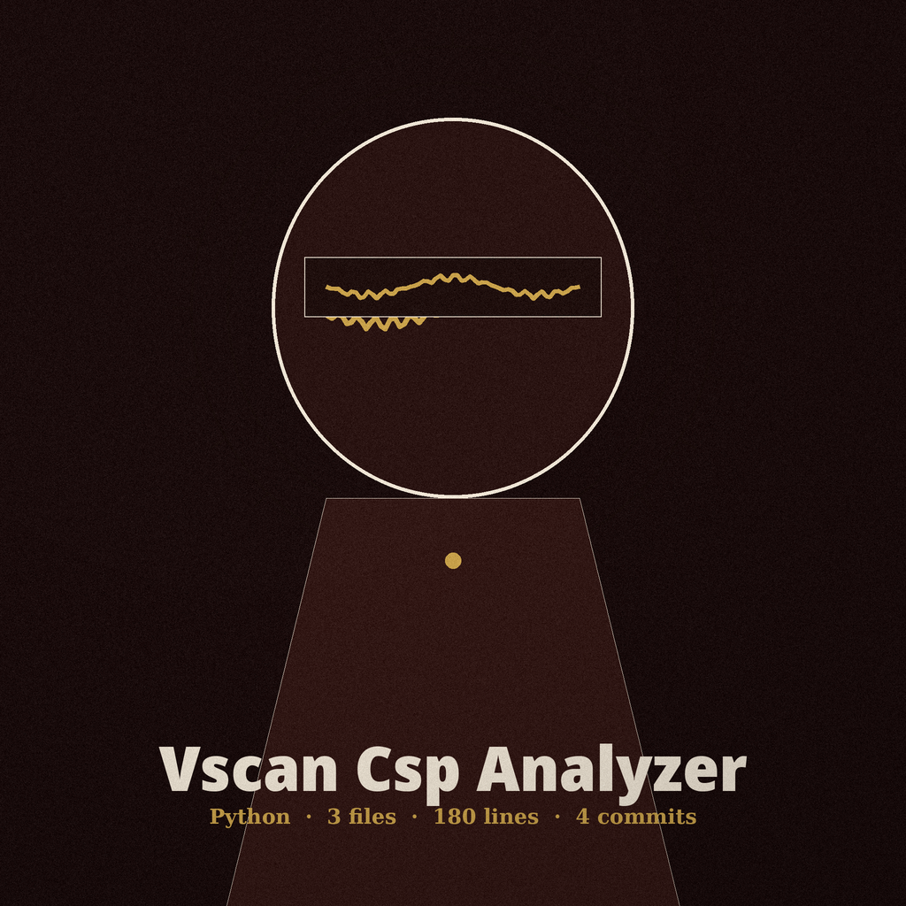
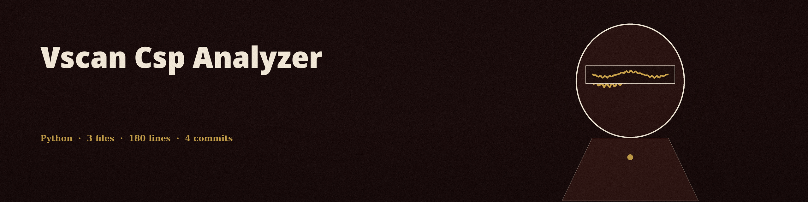

# vscan-csp-analyzer





Analyzes the Content Security Policy (CSP) header of a fetched page and reports weaknesses scoped to the directives they actually affect: `unsafe-inline` and `unsafe-eval` in script sources, `data:` granted as a source, and a bare `*` wildcard token in `script-src`, `default-src`, or `object-src`. Directive names are matched case-insensitively, and a subdomain wildcard such as `*.example.com` is not reported as a bare wildcard. A page with no CSP header is reported as a finding, "No CSP header found." A page that sends only a `Content-Security-Policy-Report-Only` header is reported as having no enforced policy. If the URL cannot be fetched at all, the tool prints a failure line and exits 1 with no analysis.

## Install

```bash
git clone https://github.com/ShadowGuard-AI/vscan-csp-analyzer
cd vscan-csp-analyzer
pip install -r requirements.txt
```

## Usage

```bash
python3 main.py <url> [-v] [-o OUTPUT]
python3 main.py http://127.0.0.1:8000/ -o findings.txt
```

## Parameters

- `url`: The URL to analyze (positional, required, must start with `http://` or `https://`)
- `-v`, `--verbose`: Enable verbose output for debugging
- `-o`, `--output`: Output file to save the results

## License

MIT. See LICENSE.
